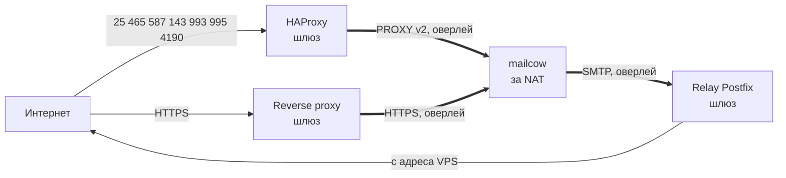

# mailcow-edge-gateway

[English](README.en.md)

Публикация mailcow, который стоит за NAT, через внешний VPS: HAProxy с PROXY protocol v2,
relay Postfix для исходящей почты и nftables с обеих сторон.

[](https://github.com/pugemon/mailcow-edge-gateway/actions/workflows/ci.yml)
[](https://pugemon.github.io/mailcow-edge-gateway/)
[](LICENSE)


**Документация: <https://pugemon.github.io/mailcow-edge-gateway/>**

## Зачем

[mailcow-dockerized](https://github.com/mailcow/mailcow-dockerized) должен работать на своём сервере
(почта, ключи и пароли — у вас), но у офиса нет белого IPv4, провайдер не даёт PTR или блокирует
порт 25, а офисный адрес в DNSBL. Обычный DNAT на VPS прячет адреса клиентов — и DNSBL, SPF, rspamd,
fail2ban становятся бесполезны. Этот проект ставит перед mailcow шлюз, который сохраняет реальные
адреса клиентов и отправляет почту с адреса с правильными PTR и SPF, не открывая в офисной сети
ни одного входящего порта.



## Возможности

- **Реальные адреса клиентов в mailcow**: HAProxy в mode tcp передаёт их заголовком PROXY v2;
  TLS терминирует сам mailcow — на шлюзе нет ни сертификата почты, ни паролей, ни писем.
- **Исходящая почта через relay** на шлюзе: HELO, PTR и SPF совпадают, DKIM не ломается.
- **Защита от подделки PROXY-заголовка** тремя независимыми барьерами: nftables на бэкенде, nftables
  на шлюзе (только пользователь `haproxy`), отказ источникам из частных сетей в HAProxy.
- **Безопасный переезд**: до переключения MX порт 25 открыт только для тестовых адресов,
  автонастройка клиентов закрыта; есть чек-лист переключения и отката.
- **Сертификат через acme.sh и DNS-01** — можно выпустить до переключения, с любым DNS API.
- **Предсказуемые скрипты**: один файл настроек на узел, план и diff (`--dry-run`), рендер без root
  (`--render DIR`), подтверждение перед изменениями (`--yes` — без вопроса), резервные копии,
  повторный запуск ничего не меняет, в конце — итог и список проверок.
- **Проверки снаружи**: `tools/check-tls.sh` (TLS на всех портах) и `tools/check-relay.sh`
  (open relay) с цветным OK/WARN/FAIL.

## Быстрый старт

Сначала бэкенд (сервер mailcow), потом шлюз. Оба узла уже в одной оверлейной сети (WireGuard или
mesh-VPN).

```sh
# на обоих узлах
sudo git clone https://github.com/pugemon/mailcow-edge-gateway /opt/mailcow-edge-gateway
cd /opt/mailcow-edge-gateway

# бэкенд
sudo cp examples/backend.conf backend.conf && sudo $EDITOR backend.conf
sudo backend/install.sh --dry-run && sudo backend/install.sh
sudo systemctl restart docker && (cd /opt/mailcow-dockerized && sudo docker compose up -d)
sudo backend/issue-cert.sh --staging && sudo backend/issue-cert.sh --production

# шлюз
sudo cp examples/gateway.conf gateway.conf && sudo $EDITOR gateway.conf
sudo gateway/install.sh --dry-run && sudo gateway/install.sh

# снаружи, с адреса из SMTP_ALLOWLIST
tools/check-tls.sh mail.example.com
tools/check-relay.sh mail.example.com
```

Подробно, с проверками после каждого шага, —
[пошаговая установка](https://pugemon.github.io/mailcow-edge-gateway/install/), затем
[переключение MX](https://pugemon.github.io/mailcow-edge-gateway/cutover/).

## Пример вывода

```text
$ tools/check-tls.sh mail.example.com
25    OK    CN=mail.example.com | до Jan 29 12:00:00 2027 GMT
465   OK    CN=mail.example.com | до Jan 29 12:00:00 2027 GMT
587   OK    CN=mail.example.com | до Jan 29 12:00:00 2027 GMT
143   OK    CN=mail.example.com | до Jan 29 12:00:00 2027 GMT
993   OK    CN=mail.example.com | до Jan 29 12:00:00 2027 GMT
995   OK    CN=mail.example.com | до Jan 29 12:00:00 2027 GMT
4190  OK    CN=mail.example.com | до Jan 29 12:00:00 2027 GMT
итого: OK 7, WARN 0, FAIL 0

$ tools/check-relay.sh mail.example.com
<<< 220 mail.example.com ESMTP
>>> EHLO client.example.net
...
>>> RCPT TO:<probe@example.net>
<<< 554 5.7.1 <probe@example.net>: Relay access denied
>>> RSET
<<< 250 2.0.0 Ok

OK    relay запрещён (554 Relay access denied)
```

## Документация

- [Обзор и схема трафика](https://pugemon.github.io/mailcow-edge-gateway/)
- [Требования](https://pugemon.github.io/mailcow-edge-gateway/requirements/) ·
  [Быстрый старт](https://pugemon.github.io/mailcow-edge-gateway/quickstart/) ·
  [Пошаговая установка](https://pugemon.github.io/mailcow-edge-gateway/install/) ·
  [Переключение MX](https://pugemon.github.io/mailcow-edge-gateway/cutover/) ·
  [Конфигурация](https://pugemon.github.io/mailcow-edge-gateway/configuration/)
- [Reverse proxy](https://pugemon.github.io/mailcow-edge-gateway/reverse-proxy/) ·
  [Сертификат mailcow](https://pugemon.github.io/mailcow-edge-gateway/certificate/) ·
  [MTA-STS](https://pugemon.github.io/mailcow-edge-gateway/mta-sts/)
- [Архитектура](https://pugemon.github.io/mailcow-edge-gateway/design/) ·
  [Модель угроз](https://pugemon.github.io/mailcow-edge-gateway/threat-model/) ·
  [Подводные камни](https://pugemon.github.io/mailcow-edge-gateway/pitfalls/) ·
  [Отладка](https://pugemon.github.io/mailcow-edge-gateway/troubleshooting/) ·
  [Справочник команд](https://pugemon.github.io/mailcow-edge-gateway/commands/)

Исходники страниц — в [`docs/`](docs/); локально: `make docs-serve`. Для разработки: `make test`,
`make lint`, `make validate` (`haproxy -c` и `nft -c` на отрендеренных примерах).

## Семейство

| Репозиторий | Назначение |
|---|---|
| [mailcow-shared-mailboxes](https://github.com/pugemon/mailcow-shared-mailboxes) | Общие ящики mailcow с доступом по LDAP/AD: права, отправка от имени, копии отправленного, профили почтовых клиентов |
| [mailcow-migration-tools](https://github.com/pugemon/mailcow-migration-tools) | Аудит и докачка при переносе почты в mailcow через sync jobs (imapsync) |
| [mailcow-edge-gateway](https://github.com/pugemon/mailcow-edge-gateway) | Публикация mailcow из-за NAT через внешний шлюз: HAProxy + PROXY protocol, relay Postfix, nftables |
| [mail-domain-check](https://github.com/pugemon/mail-domain-check) | Проверка почтовых DNS-записей и TLS: MX, SPF, DKIM, DMARC, MTA-STS, CAA, сертификаты |

## Лицензия

BSD-3-Clause, см. [LICENSE](LICENSE). Изменения — в [CHANGELOG.md](CHANGELOG.md).
