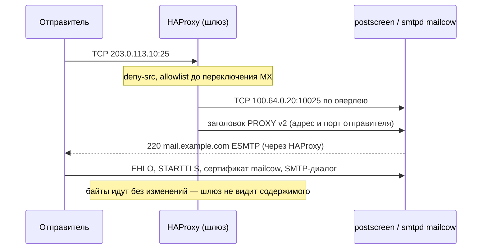

# Архитектура

Адреса в примерах: публичный адрес шлюза `203.0.113.10`, шлюз в оверлее `100.64.0.10`, бэкенд
(сервер mailcow) в оверлее `100.64.0.20`, интерфейс оверлея `wg0`, сеть контейнеров mailcow
`172.22.1.0/24` на bridge `br-mailcow` (значения mailcow по умолчанию).

## Компоненты

| Где    | Что                                   | Файлы                                                      |
|--------|---------------------------------------|------------------------------------------------------------|
| шлюз   | HAProxy, mode tcp, PROXY v2           | `/etc/haproxy/haproxy.cfg`, `deny-src.lst`, `smtp-allow.lst` |
| шлюз   | nftables, таблица `inet mail_edge`    | `/etc/mail-edge.nft`, `mail-edge.service`                  |
| шлюз   | Postfix relay на 2525                 | `/etc/postfix/main.cf`, `master.cf` (через `postconf`)     |
| шлюз   | reverse proxy для веба (NPM/nginx)    | настраивается отдельно, см. [Reverse proxy](reverse-proxy.md) |
| бэкенд | nftables, таблица `inet mailcow_edge` | `/etc/mailcow-edge.nft`, `mailcow-edge.service`            |
| бэкенд | haproxy-listeners mailcow             | `mailcow.conf` (`*_PORT_HAPROXY`), `docker-compose.override.yml` |
| бэкенд | Dovecot / nginx / Postfix mailcow     | `data/conf/dovecot/extra.conf`, `data/conf/nginx/site.real-ip-gateway.custom`, `data/conf/postfix/extra.cf` |
| бэкенд | Docker без docker-proxy               | `/etc/docker/daemon.json`                                  |
| бэкенд | сертификат (acme.sh, DNS-01)          | `data/assets/ssl/{cert,key}.pem`, `/usr/local/sbin/mailcow-cert-reload.sh` |

## Потоки трафика

**Входящая почта (25).** Отправитель подключается к `203.0.113.10:25`. HAProxy отклоняет источники из
`deny-src.lst` и (до переключения) всех, кого нет в `smtp-allow.lst`, затем открывает соединение
к `100.64.0.20:10025` и первым делом отправляет заголовок PROXY v2 с адресом отправителя. Дальше байты
идут без изменений: STARTTLS, сертификат, весь SMTP-диалог — между отправителем и postscreen mailcow.
mailcow видит реальный адрес отправителя: DNSBL, SPF, rspamd, greylisting и fail2ban работают как
при прямом подключении.

Как выглядит входящее соединение:

**Клиенты (465, 587, 143, 993, 995, 4190).** То же самое, порты 10465, 10587, 10143, 10993, 10995,
14190. TLS (неявный или STARTTLS) терминирует mailcow — на шлюзе нет ни сертификата почты, ни паролей.

**Исходящая почта.** `postfix-mailcow` отправляет всё на `relayhost = [100.64.0.10]:2525`. Docker
маскирует адрес контейнера адресом бэкенда в оверлее, поэтому relay видит `100.64.0.20` — он
единственный, кроме localhost, в `mynetworks` relay. Relay доставляет письмо получателю с
`203.0.113.10` (`smtp_bind_address`), представляясь `mail.example.com` (`smtp_helo_name` — совпадает
с PTR). Письмо уже подписано DKIM в mailcow; relay его не перекодирует.

**Веб.** Reverse proxy на шлюзе терминирует TLS своим сертификатом для `mail.`, `autodiscover.`,
`autoconfig.`, `mta-sts.` и проксирует на `https://100.64.0.20:443` с SNI исходного имени. nginx mailcow
берёт адрес клиента из `X-Forwarded-For`, доверяя только адресу шлюза (`set_real_ip_from`).

## Почему так, а не иначе

- **Белый IP и проброс портов в офис** — часто недоступно (CGNAT, динамический адрес, блокировка 25,
  нет PTR) и открывает офисную сеть наружу.
- **DNAT на VPS без PROXY protocol.** С SNAT (masquerade) mailcow видит все соединения с адреса шлюза:
  DNSBL, SPF, fail2ban и лимиты становятся бесполезны, а бан одного клиента — бан всех. Без SNAT ответы
  уходят из офиса по маршруту по умолчанию (асимметрия), нужна policy routing на бэкенде. PROXY v2
  сохраняет адрес клиента при простой маршрутизации.
- **Streams в Nginx Proxy Manager** для почтовых портов — нет PROXY protocol к бэкенду (та же проблема,
  что с SNAT) и конфликт портов с HAProxy.
- **TLS на шлюзе (HAProxy `ssl`)** — пришлось бы держать ключ сертификата почты на VPS и отдельно решать
  STARTTLS. В mode tcp шлюз ничего не знает о содержимом.
- **Встроенный ACME mailcow (HTTP-01)** — запросы на `/.well-known/acme-challenge/` для `mail.example.com`
  приходят на reverse proxy шлюза, который обслуживает их для своих сертификатов. DNS-01 не зависит от
  того, кто держит порт 80, и позволяет выпустить сертификат до переключения.
- **mailcow целиком на VPS** — проще, если допустимо хранить почту у хостера. Этот репозиторий — для
  случая, когда нельзя.

## Безопасность

Ключевое ограничение схемы — Postfix в mailcow доверяет любому PROXY-заголовку. Как его закрывают
три независимых барьера (nftables на бэкенде, nftables на шлюзе, deny-src в HAProxy) и какие риски
остаются — в [модели угроз](threat-model.md). Неочевидные детали реализации — в
[подводных камнях](pitfalls.md).
