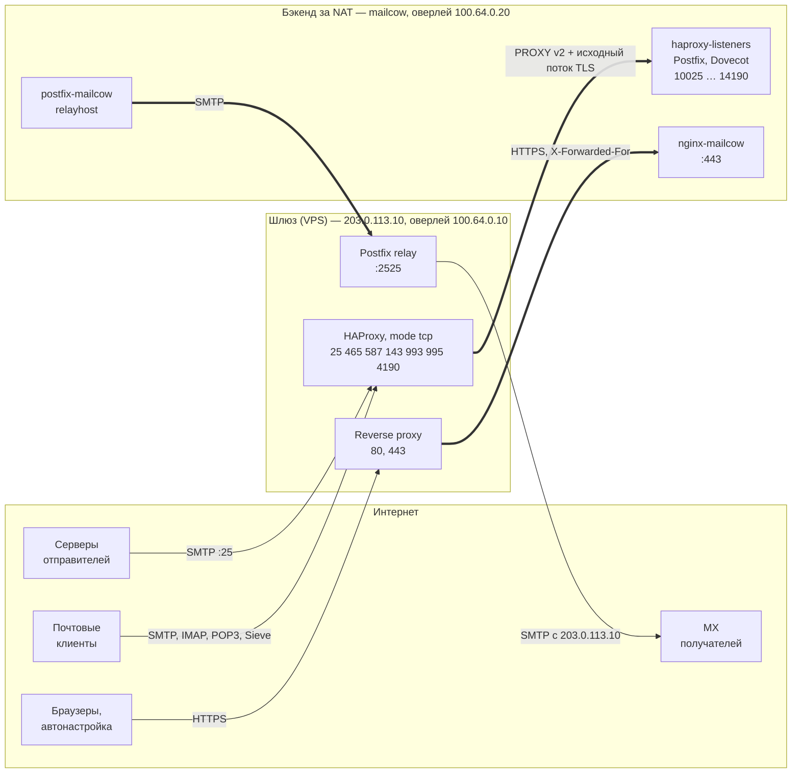

# mailcow-edge-gateway

Публикация [mailcow-dockerized](https://github.com/mailcow/mailcow-dockerized), который стоит в офисе
или за NAT, через внешний VPS — шлюз. Почта, ключи и пароли остаются на своём сервере, а в интернет
смотрит только шлюз с правильными PTR и SPF.

- **Входящие почтовые порты** (25, 465, 587, 143, 993, 995, 4190) принимает HAProxy на шлюзе и передаёт
  в mailcow по PROXY protocol v2 — mailcow видит реальные адреса клиентов: postscreen, DNSBL, SPF,
  rspamd и fail2ban работают как при прямом подключении.
- **Исходящая почта** уходит через relay Postfix на шлюзе — с адреса VPS, у которого есть PTR и
  который входит в SPF.
- **Связь шлюз ↔ mailcow** — оверлейная сеть (WireGuard или mesh-VPN): в офисе не нужны белый IP
  и проброс портов.
- **Веб** (SOGo, админка, autodiscover/autoconfig, MTA-STS) — через reverse proxy на шлюзе.

TLS на почтовых портах терминирует сам mailcow: на шлюзе нет ни сертификата почты, ни паролей
пользователей, ни писем.

## Схема трафика

Толстые стрелки — трафик внутри оверлейной сети между шлюзом (`100.64.0.10`) и бэкендом
(`100.64.0.20`). Снаружи открыты только порты шлюза; PROXY-порты mailcow и порт relay закрыты
nftables с обеих сторон — почему это обязательно, см. [модель угроз](threat-model.md).

## Когда это нужно

- mailcow должен работать на своём железе, но у офиса нет статического белого IPv4, провайдер
  не даёт PTR или блокирует порт 25;
- офисный адрес «грязный» (динамический пул в DNSBL), отправлять с него почту нельзя;
- почту нужно вывести наружу, не открывая в офисной сети ни одного входящего порта.

Если mailcow можно поставить прямо на сервер с нормальным публичным адресом, этот проект не нужен.

## Что в репозитории

| Путь | Что делает |
|---|---|
| `gateway/install.sh` | шлюз: HAProxy, таблица nftables `inet mail_edge`, вызов `setup-relay.sh` |
| `gateway/setup-relay.sh` | Postfix на шлюзе как relay исходящей почты |
| `backend/install.sh` | сервер mailcow: nftables `inet mailcow_edge`, haproxy-listeners, Dovecot, nginx, relayhost, Docker |
| `backend/issue-cert.sh` | сертификат mailcow через acme.sh и DNS-01 |
| `tools/check-tls.sh` | TLS и сертификат на всех почтовых портах |
| `tools/check-relay.sh` | проверка на open relay (до DATA, письмо не отправляется) |
| `examples/` | `gateway.conf`, `backend.conf`, конфиги reverse proxy |

Все установочные скрипты:

- читают настройки из одного файла `KEY=VALUE` (`gateway.conf` / `backend.conf`);
- показывают план и diff (`--dry-run`), записывают готовые файлы без root (`--render DIR`);
- меняют систему только после подтверждения (или `--yes`) и сохраняют предыдущие версии файлов
  в `/var/backups/mailcow-edge-gateway/<время>/`;
- идемпотентны: повторный запуск с теми же настройками ничего не меняет;
- в конце печатают итог и список проверок.

## С чего начать

1. [Требования](requirements.md) — что нужно от шлюза, бэкенда, оверлея и DNS.
2. [Быстрый старт](quickstart.md) — вся установка одним списком команд.
3. [Пошаговая установка](install.md) — то же с проверками после каждого шага.
4. [Переключение MX](cutover.md) — чек-лист переезда и отката.

## Семейство

| Репозиторий | Назначение |
|---|---|
| [mailcow-shared-mailboxes](https://github.com/pugemon/mailcow-shared-mailboxes) | Общие ящики mailcow с доступом по LDAP/AD: права, отправка от имени, копии отправленного, профили почтовых клиентов |
| [mailcow-migration-tools](https://github.com/pugemon/mailcow-migration-tools) | Аудит и докачка при переносе почты в mailcow через sync jobs (imapsync) |
| [mailcow-edge-gateway](https://github.com/pugemon/mailcow-edge-gateway) | Публикация mailcow из-за NAT через внешний шлюз: HAProxy + PROXY protocol, relay Postfix, nftables |
| [mail-domain-check](https://github.com/pugemon/mail-domain-check) | Проверка почтовых DNS-записей и TLS: MX, SPF, DKIM, DMARC, MTA-STS, CAA, сертификаты |

## Лицензия

BSD-3-Clause, см. [LICENSE](https://github.com/pugemon/mailcow-edge-gateway/blob/main/LICENSE).
