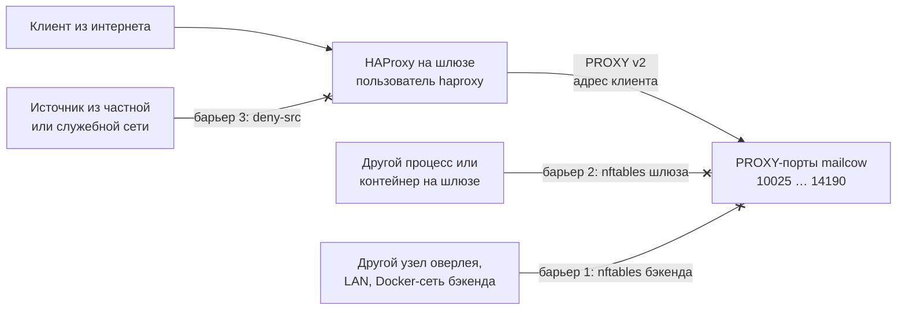

# Модель угроз

Адреса в примерах: публичный адрес шлюза `203.0.113.10`, шлюз в оверлее `100.64.0.10`,
бэкенд в оверлее `100.64.0.20`, интерфейс оверлея `wg0`, сеть контейнеров mailcow `172.22.1.0/24`
на bridge `br-mailcow` (значения mailcow по умолчанию).

## Что защищаем

- mailcow не должен стать open relay — ни через подделку адреса клиента, ни через внутренние сети;
- исходящая почта уходит только с адреса с правильными PTR и SPF (репутация домена);
- в офисной сети не открыт ни один входящий порт; связь только по оверлею;
- на шлюзе нет секретов почты (TLS-ключ, пароли, письма) — его компрометация не раскрывает переписку
  напрямую (но см. [остаточные риски](#residual)).

## Главный риск: подделка адреса в PROXY-заголовке

Postfix на haproxy-listeners mailcow (`postscreen_upstream_proxy_protocol` /
`smtpd_upstream_proxy_protocol = haproxy`) принимает PROXY-заголовок от **любого** подключившегося:
параметра «доверенные отправители заголовка» у Postfix нет. Адрес из заголовка становится адресом
клиента для всех проверок.

В `mynetworks` mailcow входят `127.0.0.0/8` и сеть контейнеров `172.22.1.0/24`. Кто сможет
подключиться к 10025/10465/10587 и написать в заголовке такой адрес, получит отправку куда угодно
без авторизации — open relay (заголовок показан в текстовом виде PROXY v1; v2 передаёт то же самое
в двоичном виде, Postfix принимает оба):

```text
PROXY TCP4 127.0.0.1 100.64.0.20 40000 10025\r\n     ← заголовок от атакующего
220 mail.example.com ESMTP
EHLO x
MAIL FROM:<spam@example.org>
RCPT TO:<victim@example.net>
250 2.1.5 Ok                                         ← «клиент из mynetworks»
```

У Dovecot список доверенных отправителей заголовка есть (`haproxy_trusted_networks`), но SMTP
важнее, а у Postfix такой настройки нет. Значит, защищать нужно не сам порт в mailcow, а **путь
к нему**: кто вообще может открыть соединение с PROXY-портом и чей адрес может попасть в заголовок.

## Три барьера

Путей к PROXY-портам три, и каждый закрыт своим барьером:



| # | Где | Механизм | Что закрывает |
|---|---|---|---|
| 1 | бэкенд | nftables `inet mailcow_edge`, `prerouting` priority mangle: к PROXY-портам `iifname wg0 ip saddr 100.64.0.10 accept`, остальное (кроме `br-mailcow`) `drop` | другие узлы оверлея, LAN офиса, другие Docker-сети на бэкенде |
| 2 | шлюз | nftables `inet mail_edge`: `output` — к PROXY-портам бэкенда только `meta skuid haproxy`, остальным `reject`; `prerouting` — транзитный трафик к ним `drop` | локальные процессы и контейнеры на шлюзе (в том числе reverse proxy в Docker) |
| 3 | шлюз | HAProxy: `tcp-request connection reject if { src -f deny-src.lst }` на каждом входе | соединения к самому HAProxy из частных и служебных сетей: их адрес попал бы в заголовок как «внешний клиент» |

### Почему именно три

- **Барьер 1** отвечает на вопрос «кто может подключиться к PROXY-порту бэкенда по сети». Порты
  опубликованы на адресе оверлея, а значит, видны всем узлам оверлея и, при неудачной маршрутизации,
  LAN офиса. Пустить можно только шлюз.
- Но «шлюз» — это адрес, а не процесс. **Барьер 2** сужает доверие с адреса до процесса: с шлюза
  к PROXY-портам ходит только пользователь `haproxy`. Иначе любой локальный процесс, cron-задача или
  контейнер на шлюзе (тот же reverse proxy в Docker — его трафик после NAT выходит с адреса шлюза)
  мог бы подключиться и написать в заголовке `127.0.0.1`.
- Даже легитимный HAProxy честно передаёт адрес источника. Если соединение к HAProxy пришло
  из частной сети — например, из контейнера на шлюзе, чья сеть совпала с сетью контейнеров mailcow, —
  этот адрес попадёт в заголовок и окажется в `mynetworks` mailcow. **Барьер 3** отклоняет такие
  источники до того, как HAProxy откроет соединение к бэкенду. Список — в
  `gateway/templates/deny-src.lst` (127/8, 10/8, 172.16/12, 192.168/16, 100.64/10, 169.254/16, 0/8),
  дополнения — `HAPROXY_DENY_SRC_EXTRA`.

Барьеры независимы: они стоят на разных узлах и в разных подсистемах (ядро бэкенда, ядро шлюза,
HAProxy), и ошибка в одном не открывает relay, пока работают остальные. Проверить каждый можно
отдельно — команды в [пошаговой установке](install.md#backend-checks), итоговая проверка снаружи —
`tools/check-relay.sh`.

Почему фильтры стоят в `prerouting` и `output`, а не в привычных `input`/`forward`, — см.
[подводные камни](pitfalls.md#mesh-vpn).

## Остальные меры

- **Docker без docker-proxy** (`"userland-proxy": false`) и **drop IPv6** на почтовые и PROXY-порты
  бэкенда — иначе IPv6-клиент виден mailcow как `172.22.1.1` ([подводные камни](pitfalls.md#docker-proxy)).
- **Dovecot `haproxy_trusted_networks = 100.64.0.10/32`** — Dovecot принимает PROXY-заголовок только
  от шлюза.
- **Relay на шлюзе**: `mynetworks = 127.0.0.0/8 100.64.0.20/32`,
  `smtpd_*_restrictions = permit_mynetworks, reject`; порт 2525 на публичном адресе закрыт таблицей
  `mail_edge`, в оверлее — только с бэкенда.
- **tcp/25 из контейнеров mailcow наружу** — `reject`, кроме публичного адреса шлюза: письма не
  уходят с офисного адреса в обход relay.
- **Порт 25 до переключения MX** — только allowlist.
- **Шлюз в whitelist Fail2ban mailcow** — защита доступности, а не конфиденциальности.

## Остаточные риски {#residual}

- **root на шлюзе** может отправить в mailcow любой PROXY-заголовок (от имени `haproxy`) и видит
  трафик веба в открытом виде (reverse proxy терминирует TLS). Шлюз — доверенный узел: обновления,
  ключи SSH, минимум сервисов.
- **Локальные процессы на бэкенде.** Пакеты, порождённые на самом хосте, не проходят `prerouting`,
  поэтому барьер 1 их не видит. Бэкенд должен быть выделенным сервером без посторонних пользователей.
  Если это не так, добавьте в таблицу `mailcow_edge` цепочку `output` по образцу шлюза:

    ```
    chain output {
        type filter hook output priority mangle; policy accept;
        ip daddr { 100.64.0.20, 127.0.0.1 } tcp dport { 10025, 10110, 10143, 10465, 10587, 10993, 10995, 14190 } meta skuid != 0 counter reject with tcp reset
    }
    ```

    (в шаблон не входит — проверьте на своей системе до включения).

- **Обычные опубликованные порты mailcow** (25, 443 и т.д. на бэкенде) доступны узлам оверлея и LAN
  напрямую, мимо шлюза. Это не relay (адрес такого клиента не в `mynetworks`), но если узлам оверлея
  нельзя доверять, ограничьте эти порты отдельно — тоже в `prerouting`.
